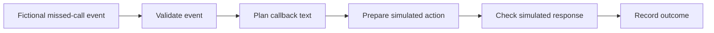

# ZenOut Labs · Automation proof

**A transparent record of eight automation demonstrations, with reusable acceptance questions.**

[ZenOut Labs](https://zenoutlabs.com/) · [How the evidence was prepared](PROVENANCE.md) · [Acceptance checklist](ACCEPTANCE-CHECKLIST.md)

Business automation should be understandable: what went in, which checks ran, what happened, and what remains untested.

On **October 18, 2026**, eight ZenOut workflows were executed in an actual n8n account with fictional data and **simulated external services**. This repository shares selected recorded results and a small tool that checks the evidence format. It is a proof notebook, not an installable workflow pack or a production service.

## Start with one example: a missed call

A fictional missed-call event entered the workflow. It passed validation, a callback text was planned, and a simulated service response was checked. The recorded outcome was `simulated_sms_accepted`, with **zero external effects**. No text message was sent.



The exact recorded steps are in the `missed` entry of [proof.json](proof.json). The diagram explains that recorded success path; it does not claim that this public package tests failure handling or a complete callback queue.

## Recorded results

| Demonstration | Recorded simulated outcome |
| --- | --- |
| Missed Call Recovery and Callback Queue | Callback text accepted by the simulator |
| Estimate Follow-Up and Revenue Recovery | Follow-up marked sent by the simulator |
| Meeting Briefing Digest | Digest assembled and marked sent by the simulator |
| Review Follow-Up and Escalation | Follow-up marked sent by the simulator |
| Consent-Safe Gmail Outreach | Message marked sent by the simulator |
| Content Queue and Publisher | Draft awaiting human review |
| Public Business Research Queue | Sample research ready |
| Ad Response and Voice Receptionist | Sample appointment marked booked |

The same project also recorded **44/44 Neon PostgreSQL checks in rollback-only transactions**. Those changes were rolled back. This does not establish durable production writes, connected messaging, a customer installation, revenue, or readiness for sale.

## Check the published records yourself

Install Node.js 22 or newer from [the official Node.js website](https://nodejs.org/). Download this repository, open a terminal in its folder, and run:

```sh
node verify.mjs
node --test verify.test.mjs
```

No package installation, account, credentials, database, or network connection is needed to run these commands. The first checks record structure and boundaries. The second checks that the verifier rejects misleading changes such as relabeling a simulated run as live. Neither command reruns n8n, the private workflows, or Neon.

## What still needs verification

- Actual external providers and end-user delivery, including failure and duplicate-event behavior.
- Restricted production database access and persistent writes.
- Current hosted checkout, delivery, recovery, and a customer installation.

These are future acceptance tasks, not completed results. The source project continues separately.

## Reuse and contribution

The [acceptance checklist](ACCEPTANCE-CHECKLIST.md) can help you describe your own automation evidence clearly. Suggestions that improve clarity or the evidence verifier are welcome through an issue or pull request. Please use fictional examples and keep credentials and customer information private.

Prepared with OpenAI Codex assistance from ZenOut's own project records. The included code and documentation are MIT licensed; see [LICENSE](LICENSE). No third-party workflow pack, n8n runtime, customer records, or private workflow source is included.
